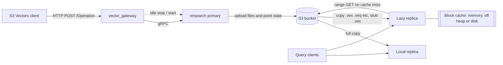
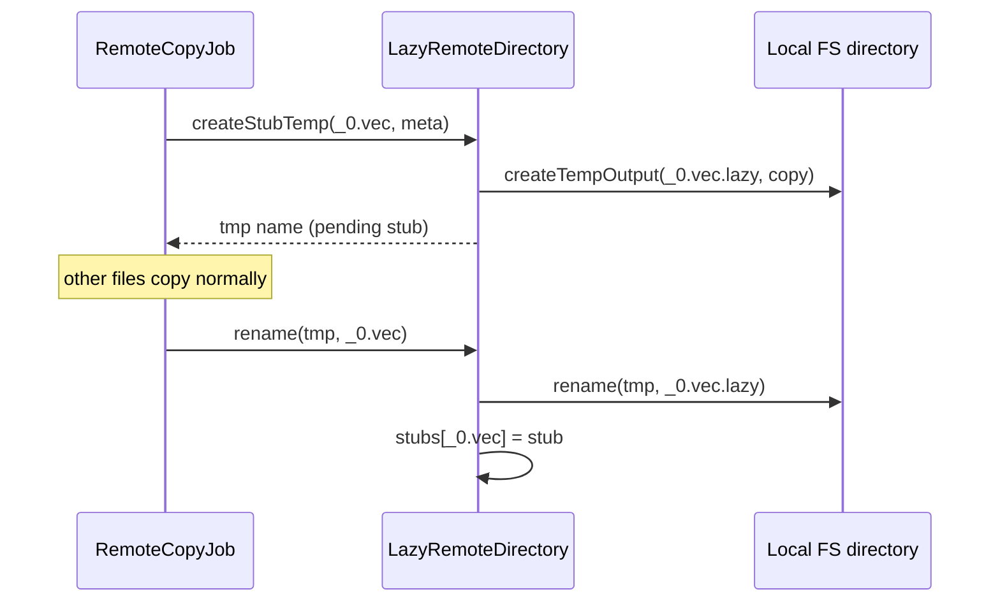
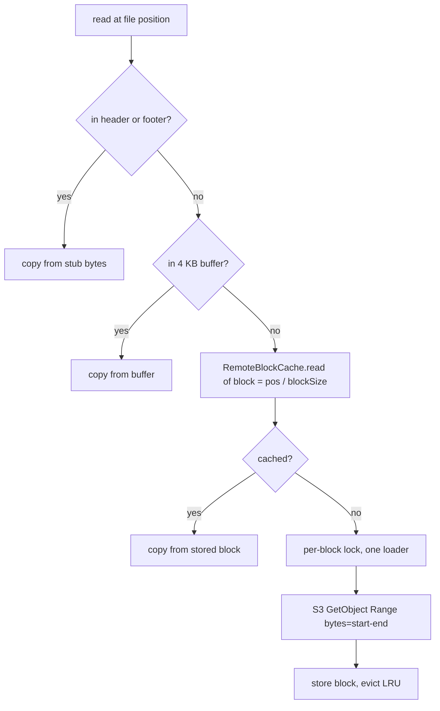

# S3 Vectors on nrtsearch

An S3 Vectors compatible API backed by nrtsearch, plus replicas that leave full precision vectors in S3 and read them by byte range, so vector data costs about a fifth of the local disk.

| Author | Status | Updated | Scope |
|---|---|---|---|
| Andrew Prudhomme | Draft, prototype | 16 Nov 2026 | Branch `s3_vectors`, 66 files, +11.4k lines vs main |

## Contents

1. [Summary](#1-summary)
2. [Background](#2-background)
3. [Architecture](#3-architecture)
4. [Lazy remote data on replicas](#4-lazy-remote-data-on-replicas)
5. [Block cache](#5-block-cache)
6. [Vector gateway](#6-vector-gateway)
7. [Query path](#7-query-path)
8. [Idle index tiering](#8-idle-index-tiering)
9. [Benchmark tooling](#9-benchmark-tooling)
10. [Operations and failure modes](#10-operations-and-failure-modes)
11. [Known issues](#11-known-issues)
12. [Testing](#12-testing)
13. [Open questions and future work](#13-open-questions-and-future-work)
14. [Change inventory](#14-change-inventory)

## 1. Summary

This branch adds three pieces that work together:

- **Lazy remote data.** Isolated replicas can keep chosen index files (by default `.vec`, the full precision vectors) in S3 instead of downloading them. Each such file is a small local stub. Reads fetch fixed size blocks with S3 range requests into a node wide block cache kept on the heap, off heap, or on disk.
- **Vector gateway.** An HTTP/JSON service (`vector_gateway`) that implements the core S3 Vectors operations on an nrtsearch primary: buckets, indexes, put, get, delete, list and query with metadata filters. It can stop idle indexes and restore them from S3 on the next request.
- **Benchmark tooling.** `vector_bench` and scripts that run a primary plus a lazy replica and a fully local replica, load an index, and compare latency, recall, S3 traffic and disk use.

### Goals

- Cut replica disk and page cache for quantized vector indexes by leaving data that queries rarely touch in S3.
- Keep the change transparent to Lucene: the replica sees a normal directory with normal files.
- Offer an API that existing S3 Vectors clients can call with little change.
- Let one cluster hold many more vector indexes than fit in memory, by stopping unused ones.

### Non-goals

- Authentication, IAM, encryption settings, tags and ARNs.
- Lazy loading on primaries or on replicas that copy from the primary over gRPC.
- Lazy loading of files inside compound (`.cfs`) files or files uploaded compressed.
- A durable, replicated gateway registry. The prototype keeps it in one local JSON file.

## 2. Background

### Why `.vec` can stay remote

A Lucene field using HNSW with scalar quantization writes three data files per segment. Every query reads the graph and the quantized vectors. The full precision vectors are read only to rescore the top `k × oversample` candidates, and to return vector data.

| File | Holds | Read by | Bytes per vector, 768 dims |
|---|---|---|---:|
| `.vex` | HNSW graph | Every query | ≈ 50–130 (M=16) |
| `.veq` | 7 bit quantized vectors plus a correction float | Every query | ≈ 772 |
| `.vec` | float32 vectors | Rescoring and returnData only | 3,072 |

At one million 768 dimension vectors, `.vec` is about 3.1 GB of about 4 GB of vector data. Leaving it in S3 cuts local vector data roughly 5x with 7 bit quantization, and more with 4 or fewer bits.

### Isolated replicas

nrtsearch isolated replicas (`isolatedReplicaConfig.enabled`) take no traffic from the primary. They poll S3 for new point states and copy changed files with `RemoteCopyJob`. Every file they need is already in S3 under a unique backend name (`<timeString>-<primaryId>-<fileName>`), and that name never maps to different content. That is what makes reading a file in place from S3 safe.

## 3. Architecture



The gateway talks only to the primary. Replicas serve reads; the lazy replica reads `.vec` blocks from S3 through its cache.

The server side changes are additive and off by default. With `lazyRemoteData.enabled: false`, or on any node that is not an isolated replica, nothing changes except one new metrics collector.

## 4. Lazy remote data on replicas

### Configuration

```yaml
isolatedReplicaConfig:
  enabled: true
lazyRemoteData:
  enabled: true
  extensions: [vec]      # matched on the last extension, case insensitive
  cacheType: MEMORY      # MEMORY | OFF_HEAP | DISK
  cacheDir: ""           # DISK only; default <indexDir>/lazy_remote_cache, emptied on start
  cacheSizeMB: 512
  blockSizeKB: 64        # 4 to 65536
```

`LazyRemoteDataConfig` validates the values. It is read for every node, but `ShardState.startReplica` uses it only when isolated replicas are also enabled.

### Stub files

A lazy file `_0.vec` exists locally as `_0.vec.lazy`, a small JSON document (`LazyFileStub`) holding the remote index identifier and the file's `NrtFileMetaData`: length, Lucene header and footer bytes, checksum, and the time string and primary id that form its S3 key. A stub is a few hundred bytes for a file of gigabytes.

Because the stub carries the header and footer, Lucene can open the file, check its codec header, read its checksum and compare its identity with a primary's copy without touching S3. Replicas do this for every file of every new index version.

### Restore path

`NrtDataManager.restoreIfNeeded` takes an optional `LazyRemoteDataConfig`. When set, it writes stubs for lazy, uncompressed files in the point state with `LazyRemoteDirectory.writeStubsForRestore` (temp file plus atomic move), removes those files from the download list, and downloads the rest as before.

### Copy path

For each file it copies, `RemoteCopyJob.visit` first calls `writeLazyStub`. If the destination directory unwraps to a `LazyRemoteDirectory`, the extension is lazy and the file is not compressed, the job writes the stub to a temp output and records it in `copiedFiles` exactly like a copied file. That gives stubs the normal copy job lifecycle: `finish()` renames the temp into place, and a cancelled job deletes it.



### Directory semantics

`LazyRemoteDirectory` is a `FilterDirectory` over the real directory, placed before the `NRTCachingDirectory` decision (which still looks at the real directory type). It keeps an in-memory map from file name to stub, loaded from disk when opened, so lookups need no file system calls.

| Operation | Behavior for a lazy file |
|---|---|
| `listAll` | Reports `_0.vec` in place of `_0.vec.lazy`; temp files pass through. |
| `fileLength` | The real remote length from the stub. |
| `openInput` | A `LazyRemoteIndexInput` that reads through the block cache. |
| `deleteFile` | Deletes the stub, any real file beside it, and the file's cached blocks. |
| `rename` | A pending stub becomes the stub for the destination. A real file renamed over a stub replaces it. |
| `sync` | Syncs the stub file in place of the logical name. |

### Read path

`LazyRemoteIndexInput` implements `IndexInput` and `RandomAccessInput`. It serves the header and footer from the stub, buffers small reads in a 4 KB buffer, and sends larger reads straight to the cache, one block at a time. Clones and slices get their own buffer, so each search thread's reads stay independent.



`S3Backend.readIndexFileRange` builds the same object key as a normal download, issues a ranged `GetObject`, checks that exactly the requested bytes came back, and refuses compressed files. Range reads count toward download metrics but skip the download rate limiter, which is meant for bulk restores. Retries come from the S3 client's retry policy. Other backends inherit a default that throws `UnsupportedOperationException`.

### Constraints

- Only isolated replicas. Other replicas copy from the primary and never use the lazy path.
- Files must be uploaded uncompressed. Compressed files are downloaded normally, silently.
- Files inside compound files are not lazy, so the gateway turns compound files off for its indexes.
- The extension list is node wide. A non-quantized HNSW field reads `.vec` on every graph step, so turning lazy loading on for such an index makes every query S3 bound.

## 5. Block cache

`RemoteBlockCache` is one LRU cache per node, created on first use by `GlobalState.getLazyRemoteBlockCache` and shared by every lazy file. A block is keyed by file id (remote index identifier plus backend file name, unique per content) and block number.

- **Lookup.** An access ordered `LinkedHashMap` under the cache monitor. Readers copy bytes out of the stored block, so storage can live anywhere.
- **Miss coalescing.** Concurrent misses on one block wait on a per-block lock object; one thread loads, the rest find it cached.
- **Accounting.** Bytes of stored blocks plus blocks being stored. A block is cached only if room can be made by evicting from the LRU end.

| Type | Storage | Fits | Cost |
|---|---|---|---|
| `MEMORY` | One heap array per block | Small caches | Adds to heap and GC work; keep blocks under half a G1 region. |
| `OFF_HEAP` | 64 MB direct buffer slabs of fixed slots, allocated as the cache fills | Large in-memory caches | Needs `-XX:MaxDirectMemorySize` ≥ cache size. A short last block still uses a whole slot. A per-slot read/write lock and owner key make slot reuse safe. |
| `DISK` | One file per block under `cacheDir` | Caches larger than memory | A file open and read per hit, usually served by the OS page cache. Directory emptied on start. |

### Metrics

`LazyRemoteCacheCollector` exports, with a `cache_type` label: hits, misses, remote bytes, remote load seconds, load errors, evictions, size, block count, max bytes, block size and allocated bytes, all prefixed `nrt_lazy_remote_cache_`. Average S3 block latency is remote load seconds divided by misses.

## 6. Vector gateway

`VectorGatewayServer` runs the JDK `HttpServer` with a fixed thread pool (32 by default). Each operation is `POST /<Operation>` with a JSON body of at most 20 MiB. Errors return an HTTP status and `{"__type", "message"}`, as S3 Vectors does. `VectorService` implements the operations over blocking and async gRPC stubs to one primary.

| Operation | Limits and behavior |
|---|---|
| Create/Get/List/DeleteVectorBucket | Names 3 to 63 lowercase letters, digits and hyphens. A bucket must be empty to delete. At most 10,000 indexes per bucket. |
| Create/Get/List/DeleteIndex | `float32`, dimension 1 to 4,096, `cosine` or `euclidean`, up to 10 non-filterable metadata keys. |
| PutVectors | Up to 500 per request, keys up to 1,024 bytes, metadata up to 40 KB and 50 keys, filterable part up to 2 KB. Upsert by key. |
| GetVectors | Up to 100 keys, optional data and metadata. |
| DeleteVectors | Up to 500 keys. |
| ListVectors | Key order, up to 1,000 per page, `nextToken` paging. No parallel segments. |
| QueryVectors | `topK` up to 10,000, optional filter, distance and metadata. |

### Data model

Each vector index is one nrtsearch index named `vb_<bucket>__<index>`. Bucket and index names cannot contain `_`, so the name is unambiguous.

| Field | Type | Purpose |
|---|---|---|
| `_key` | `_ID` | Vector key; makes adds upserts and drives deletes. |
| `_sort_key` | `ATOM`, doc values | Sort and `search_after` paging for ListVectors. |
| `_vector` | `VECTOR`, `hnsw_scalar_quantized` | Search. No doc values, so each vector is stored once; returnData reads `.vec`. |
| `_meta` | `ATOM`, stored | All metadata as JSON for returnMetadata. |
| `m_<key>` | `ATOM`, `DOUBLE` or `BOOLEAN`, multivalued | One per filterable metadata key, registered on first sight. |

### Metadata schema

S3 Vectors metadata is schemaless; nrtsearch fields are typed. `MetadataSchema` records a type per filterable key the first time it appears (string, number or boolean; a list takes its elements' type) and rejects later values of another type. Keys map to field names matching `[a-zA-Z_][a-zA-Z_0-9]*`, with a numeric suffix when two keys collide. A PutVectors request validates everything first, then registers new fields with `updateFields` under the schema's lock, rolls back its own keys if that fails, and saves the registry.

### Filters

`FilterTranslator` turns the S3 Vectors filter language into nrtsearch queries: `$eq`, `$ne`, `$gt`, `$gte`, `$lt`, `$lte`, `$in`, `$nin`, `$exists`, `$startsWith`, `$and`, `$or`. A bare value means `$eq`, sibling keys combine with AND, list values match if any element matches, and `$ne`/`$nin` match vectors without the key. A comparison against a key of a different type matches nothing. A filter may have at most 100 constraints, counting each `$in` value.

### Registry

`BucketRegistry` holds buckets, index configs and metadata schemas in memory and saves them to a JSON file (temp plus atomic move) after each change. Index creation reserves the name first, so a failed create releases it and deletes the half built nrtsearch index. Without `--registryFile` the registry is lost when the gateway stops.

### Consistency

By default each PutVectors and DeleteVectors refreshes the index before returning, and reads go to the primary, so a write is visible to the next query. `--noRefreshOnWrite` trades that for throughput and relies on the server's periodic refresh.

## 7. Query path

1. Validate the vector (dimension, finite values, non-zero for cosine) and `topK`.
2. Build a KNN query with `k = topK` and `numCandidates = min(10000, max(topK, minNumCandidates))`.
3. For quantized indexes, add `rescore_vector` with `--rescoreOversample` (3 by default). The server searches `ceil(k × oversample)` candidates on quantized vectors and rescores them with full precision vectors.
4. Translate the filter and apply it with the `ACORN` filtered HNSW strategy, which falls back to exact search when the filter is very selective. This matches S3 Vectors' `ENHANCED` mode: a query returns `topK` results whenever enough vectors match.
5. Convert scores to S3 Vectors distances with `DistanceConverter`.

| Metric | nrtsearch score | Returned distance |
|---|---|---|
| cosine | `(1 + cos) / 2` | `1 − cos = 2 − 2·score` |
| euclidean | `1 / (1 + d²)` | `d = √(1/score − 1)` |

On a lazy replica, the rescoring in step 3 is the only regular reader of `.vec`. Each candidate needs one block, so a cold cache costs up to `topK × oversample` S3 GETs per segment.

## 8. Idle index tiering

With `--idleStopSeconds`, `IndexTiering` checks every `--idleCheckSeconds` for indexes with no requests for that long. It commits each one, so S3 has all its data, then stops it. The next request starts it with `startIndexV2`, which restores from S3. This needs the server to use `dataLocationType: REMOTE`.

- Requests hold a per-index read lock, so an index is never stopped mid request. Start and stop take the write lock; the idle checker uses `tryLock` and skips busy indexes.
- An index whose state is unknown, for example after a gateway restart, is checked with nrtsearch on its first request and is not stopped before that.
- The first request after a stop waits for the restore.

## 9. Benchmark tooling

`scripts/vector_bench/cluster.sh` runs three local processes against a real S3 bucket: a primary that uploads every refresh, a lazy isolated replica, and a local isolated replica as the baseline. It checks S3 access and that the primary has published cluster state before starting replicas.

`vector_bench` subcommands: `setup`, `load`, `stream`, `groundtruth`, `query`, `info` and `indexdir`. Data is a seeded mixture of Gaussian clusters, so vector *i* depends only on the seed and *i*, or a standard `.fvecs` set such as SIFT1M. Every vector gets `category` and `bucket` metadata, so ground truth can include filtered queries.

`run_benchmark.sh` creates and loads the index, force merges to one segment by default so runs are comparable, computes exact neighbors, waits for both replicas to serve the primary's version, then queries the local replica, the lazy replica cold (just restarted) and warm. It reports throughput, latency percentiles measured from each query's scheduled start, recall, S3 cache deltas, and local disk use of the current index version by file extension.

## 10. Operations and failure modes

| Failure | Effect | Handling |
|---|---|---|
| S3 slow or throttling | Rescoring latency rises on misses | S3 client retries with backoff; load errors and load time are metered. |
| S3 range read fails | The query fails | No local fallback; `load_errors` counts it. |
| S3 object deleted by cleanup | Queries touching that segment fail | Cleanup retention must exceed the longest a replica can lag (see issue 6). |
| Cache allocation fails (off heap) | Blocks are read without caching | Logged once; see issue 3. |
| Copy job cancelled | Pending stubs left as temp files | Deleted with the job's other temp files. |
| Gateway registry save fails | The change is rolled back in memory | Create bucket and add index roll back. Delete paths do not. |
| Index restore after idle stop | First request waits | No timeout today; see issue 7. |

Rolling out lazy loading means enabling it on new isolated replicas. Turning it off on a node with existing stubs needs a restore that deletes existing data, or the stubs will refer to files Lucene cannot find.

## 11. Known issues

From the branch review. None are fixed yet.

| # | Severity | Issue | Detail |
|---|---|---|---|
| 1 | High | Metrics scrape blocks during index start | `GlobalState.getLazyRemoteBlockCacheIfCreated` is synchronized on the same monitor as `startIndexV2`, which holds it through a full restore. Make the field volatile and drop the lock from the getter. |
| 2 | High | Gateway listens on all interfaces without auth | Anyone who can reach the port can create and delete indexes. Add `--host` defaulting to 127.0.0.1 and document the lack of auth. |
| 3 | High | Off heap cache retries failed allocation under the lock | After direct memory runs out, every miss retries a 64 MB `allocateDirect` (GC plus about 0.5 s of sleeps) while holding the cache monitor, stalling all reads. Stop retrying once allocation fails. |
| 4 | Medium | Duplicate stores leak cache capacity | `store` does not recheck before `lru.put`, so two stores of one block leave one block's bytes, or an off heap slot, counted forever. |
| 5 | Medium | Invalidation scans the whole cache under the lock | Every deleted lazy file triggers a full LRU scan, plus disk deletes for `DISK`. File ids are unique, so invalidation can be dropped or indexed by file. |
| 6 | Medium | Queries depend on S3 retention | Replicas now read S3 for the life of a segment. A lagging replica fails queries once cleanup removes its files. SDK client errors escape range reads unchecked. |
| 7 | Medium | `startTimeoutMs` is unused | Gateway gRPC calls have no deadlines, so a hung start or search ties up a gateway thread indefinitely. |

## 12. Testing

| Area | Tests |
|---|---|
| Lazy directory and input | `LazyRemoteDirectoryTest`, `LazyRemoteIndexInputTest`, `RemoteCopyJobLazyTest` |
| Block cache | `RemoteBlockCacheTest`, `OffHeapBlockCacheTest`, `LazyRemoteCacheCollectorTest` |
| End to end replica | `LazyVectorReplicaIntegrationTest` |
| Gateway units | `BucketRegistryTest`, `MetadataSchemaTest`, `FilterTranslatorTest`, `DistanceConverterTest`, `IndexTieringTest`, `VectorGatewayCommandTest` |
| Gateway end to end | `VectorGatewayIntegrationTest` |
| Bench tools | `VectorBenchUnitTest`, `VectorBenchIntegrationTest` |

Still to add: tests for each known issue fix, and benchmark results at 1M vectors across cache sizes, block sizes and cache types, with streaming writes, and comparing cold start time against a full download.

## 13. Open questions and future work

- **Prefetch.** Rescoring knows all its candidates up front. Issuing their block reads in parallel, through Lucene's `prefetch`, would turn up to `k × oversample` serial GETs into one round of concurrent ones.
- **Block size.** Rescoring reads are scattered and a vector is 3 KB at 768 dims, so 64 KB blocks fetch mostly unused data. Benchmarks should settle the default.
- **Retention.** Should cleanup know about lazy replicas, or should replicas fall back to downloading a file when its object is gone?
- **Gateway state.** Move the registry next to the nrtsearch global state in S3, and reconcile metadata fields with nrtsearch on start.
- **Gateway reads.** Queries go to the primary. Routing them to replicas needs a freshness story to keep read-your-writes.
- **API gaps.** Parallel ListVectors, per key mixed types, auth.

## 14. Change inventory

Package paths are under `src/main/java/com/yelp/nrtsearch/`.

### Server

- `config/LazyRemoteDataConfig.java` (new)
- `config/NrtsearchConfig.java`
- `nrt/lazy/LazyFileStub.java` (new)
- `nrt/lazy/LazyRemoteDirectory.java` (new)
- `nrt/lazy/LazyRemoteIndexInput.java` (new)
- `nrt/lazy/RemoteBlockCache.java` (new)
- `nrt/NrtDataManager.java`
- `nrt/jobs/RemoteCopyJob.java`
- `nrt/state/NrtFileMetaData.java`
- `remote/RemoteBackend.java`
- `remote/s3/S3Backend.java`
- `index/ShardState.java`
- `state/GlobalState.java`
- `monitoring/LazyRemoteCacheCollector.java` (new)
- `grpc/NrtsearchServer.java`

### Gateway, tools and docs

- `vectors/VectorGatewayCommand.java`
- `vectors/VectorGatewayServer.java`
- `vectors/VectorService.java`
- `vectors/BucketRegistry.java`
- `vectors/IndexConfig.java`
- `vectors/MetadataSchema.java`
- `vectors/FilterTranslator.java`
- `vectors/IndexTiering.java`
- `vectors/DistanceConverter.java`
- `vectors/VectorsException.java`
- `tools/vector_bench/*` (15 files)
- `scripts/vector_bench/*` (`cluster.sh`, `run_benchmark.sh`, configs)
- `docs/vector_gateway.rst`, `docs/server_configuration.rst`
- `build.gradle` (`vector_gateway`, `vector_bench` scripts)

Written from the `s3_vectors` branch at commit 6b00fda5.
